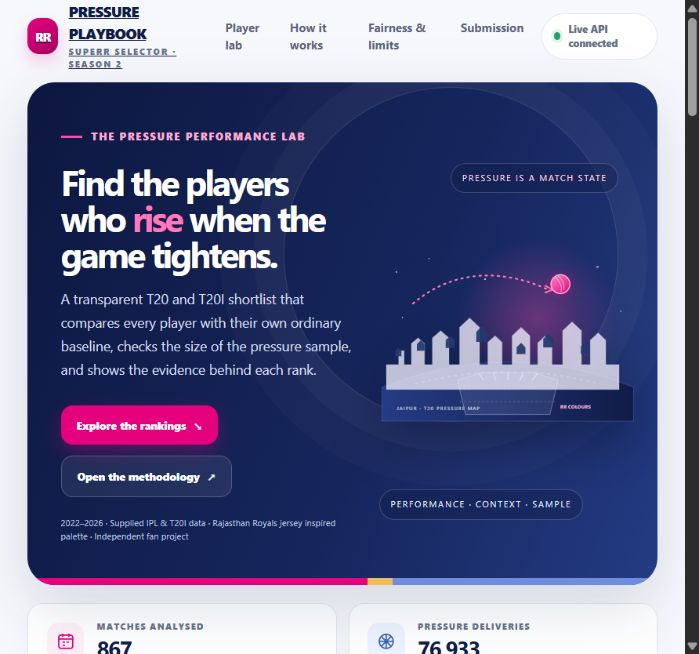
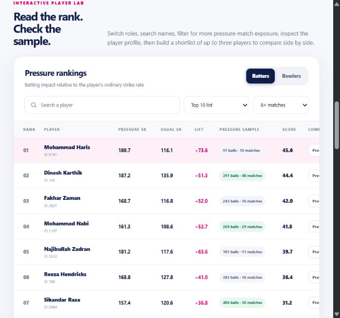
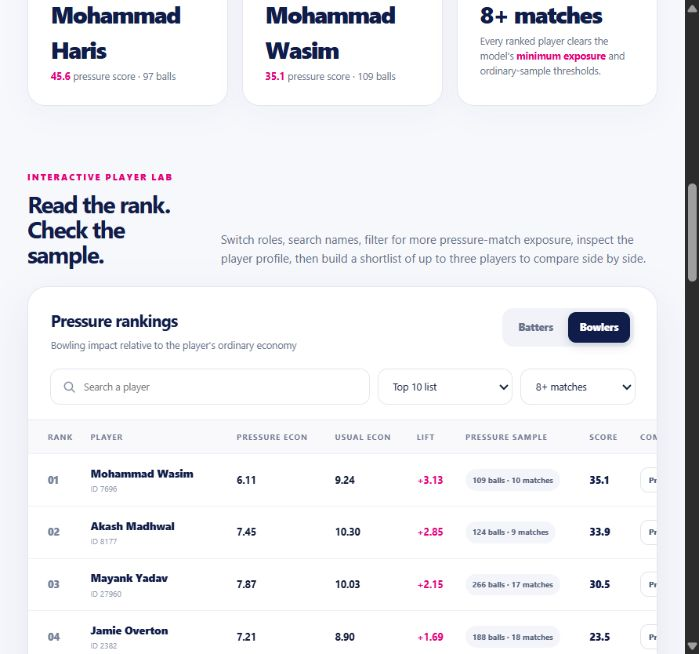
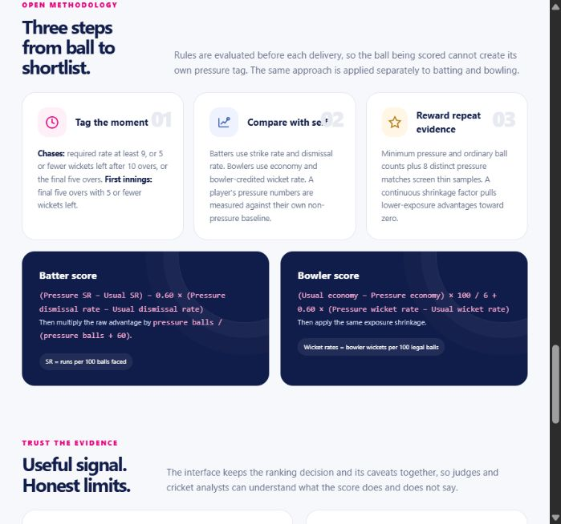

# Pressure Playbook | SupeRR Selector Season 2

An evidence-led T20/T20I pressure-performance explorer, built for the SupeRR Selector Season 2 challenge. The interface uses an original Rajasthan Royals jersey-inspired pink and blue palette and original vector artwork; it is an independent fan project and is not affiliated with the team.

## Live dashboard

Explore the deployed dashboard and its interactive player rankings:

[pressure-selector-rr.onrender.com](https://pressure-selector-rr.onrender.com)

### Live dashboard home



### Batter rankings



### Bowler rankings



### Methodology



## What it does

- Ranks eligible batters and bowlers by pressure output relative to each player's own ordinary baseline.
- Shows pressure and ordinary rates, rate lift, sample deliveries, pressure-match exposure, and the reliability-adjusted score.
- Filters by name and pressure-match sample size, opens an evidence profile, and compares up to three players.
- Exports the ordered top-ten CSVs and a custom comparison shortlist.
- Includes an offline snapshot in the HTML and loads the same packaged rankings from the API when hosted.

The RR colors are a visual theme. The rankings use eligible players across the supplied IPL and T20I dataset; they are not limited to Rajasthan Royals squad members.

## Run locally

Requires Node.js 20 or newer. From this directory:

```powershell
npm start
```

Open `http://localhost:10000`. The server uses `PORT` when supplied and binds to `0.0.0.0` for Render.

## Read-only API

- `GET /healthz` - service health.
- `GET /api/summary` - dataset and eligibility counts.
- `GET /api/rankings?type=batters&limit=10` - ranked batters; use `bowlers` for bowlers and `all` for every eligible player.
- `GET /api/rankings?type=batters&search=Haris` - filter by player name; search works with the `limit` parameter.
- `GET /api/players/8741?type=batters` - one player record.

The dashboard fetches the rankings and summary from these endpoints. If the API is unavailable, it displays the embedded snapshot and labels it as offline data.

## Method in brief

Pressure tags use match state before the delivery. For second innings, a required run rate of at least 9, 5 or fewer wickets remaining after 10 overs, or the final five overs triggers pressure. For first innings, the final five overs are pressure when 5 or fewer wickets remain. Super overs are excluded; revised targets and shortened allocations are used when provided.

Batters need at least 60 pressure balls, 200 ordinary balls, and 8 pressure matches. Bowlers need 60 pressure legal balls, 180 ordinary legal balls, and 8 pressure matches. Scores compare strike rate and dismissal rate for batters, and economy and bowler-credited wicket rate for bowlers. The raw advantage is shrunk toward zero according to pressure-ball exposure. Full definitions, formulas, evidence tables, and limitations are in `pressure_performance_methodology.pdf`.

## Rebuild the dashboard

After updating `data/rankings.json` and `data/summary.json`, rebuild both the hosted page and the standalone offline page with:

```powershell
npm run build
```

To recompute the rankings from the supplied data pack, install Python 3.10+, NumPy, and pandas, then run from this directory:

```powershell
python pressure_model.py --data-pack "path/to/6af458274c1e8_data_pack.zip"
```

This writes the full leaderboards, top-ten CSVs, and the API's `data/rankings.json` and `data/summary.json`. Run `npm run build` to rebuild the site from that output. The scoring code is in `pressure_model.py`.

## Deploy on Render

The root `Dockerfile` packages the dashboard and read-only API. The GitHub Actions workflow publishes `ghcr.io/abhinav2404-hub/rajasthan-royals-pressure-selector:latest` to GitHub Container Registry. After the first image is published, set the package visibility to public, then create a Render Web Service using **Existing Image** and that image URL. Render runs the container and serves the app; GitHub is only the source and image registry. See [Render's prebuilt image deployment guide](https://render.com/docs/deploying-an-image).

The root `render.yaml` is also available for the Git-backed Blueprint route if you prefer to connect the repository directly. The app uses `PORT`, binds to `0.0.0.0`, and exposes `/healthz` for service health.

## Submission files

- `batter_top10.csv` and `bowler_top10.csv` preserve the two ordered lists for the Unstop selectors.
- `pressure_performance_methodology.pdf` explains the pressure definition, scoring, fair-comparison checks, evidence, reliability, limitations, and reproduction steps.
- `UNSTOP_SUBMISSION_GUIDE.md` gives the ranked names in entry order and a short upload checklist.
